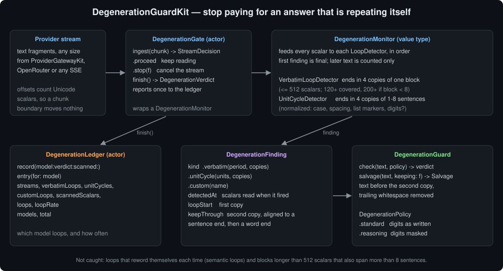
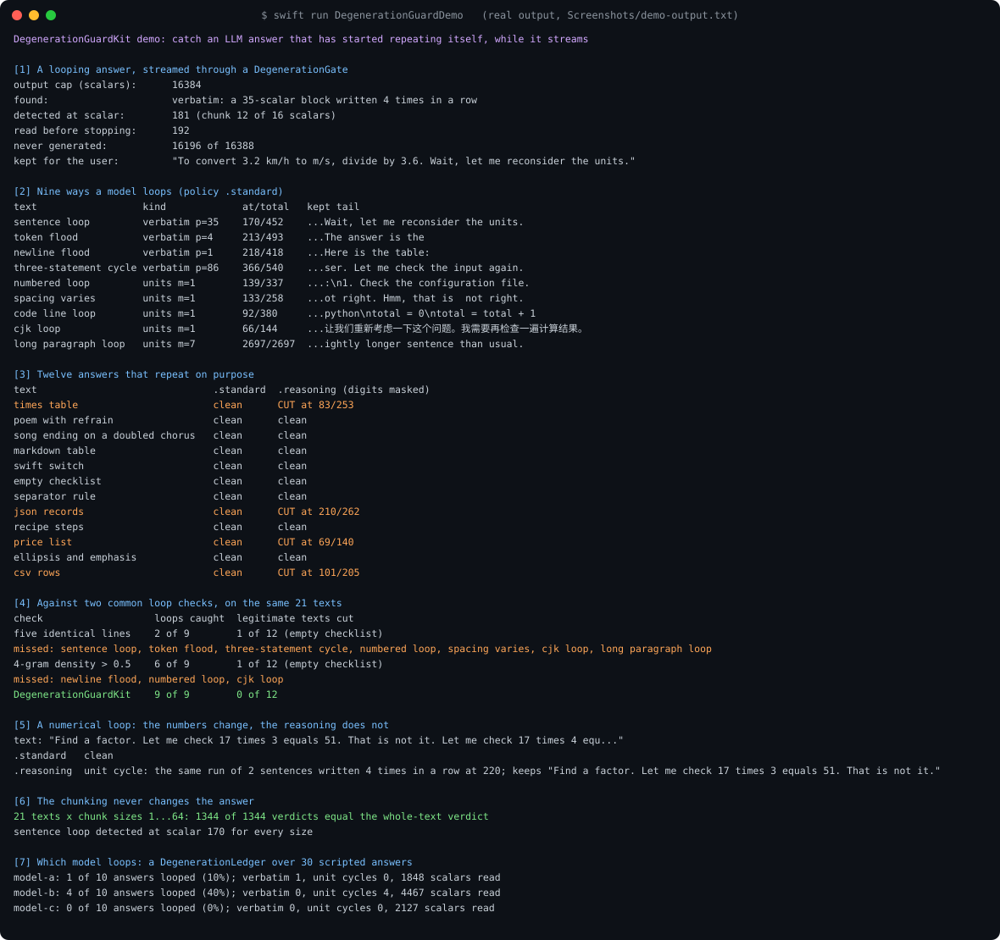
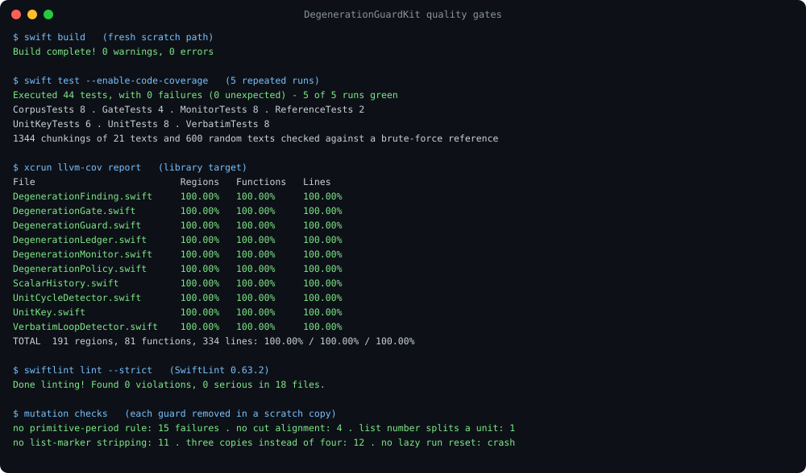

# DegenerationGuardKit



Sometimes a model stops answering and starts repeating itself: "Wait, let me reconsider the
units." forty times, a run of " the the the", a numbered list whose every item is the same, or
hundreds of blank lines. It rarely recovers. It keeps going until it reaches the output cap, and
every one of those tokens is billed, streamed to the screen and stored in the history.

A streaming client is the one place that can stop this early: it sees each fragment as it
arrives and can cancel the request. DegenerationGuardKit watches the stream and reports the first
point at which the text ends in the same thing four times in a row. It says what repeated and
where the repetition began, so the caller can stop reading and keep one copy. In this package's
demo, a looping answer streamed against a 16,384-scalar cap is stopped after **192** scalars. The
other **16,196** are never generated, and the user is left with the sentence that came before the loop plus one copy
of the loop.

Part of the Swift LLM ecosystem around
[`ProviderGatewayKit`](https://github.com/rajatslakhina/foundation-model-provider-gateway).

## Why

Repetition survives the usual sampling controls, and when it happens it is expensive:

- *LZ Penalty* ([arXiv 2504.20131](https://arxiv.org/abs/2504.20131)) reports that "both the
  industry-standard frequency penalty and repetition penalty are ineffective", with degenerate
  repetition in up to 4% of generations from open reasoning models under greedy decoding.
- *Circular Reasoning* ([arXiv 2601.05693](https://arxiv.org/abs/2601.05693), January 2026)
  describes loops in large reasoning models as self-reinforcing: the repeated text becomes the
  premise for repeating it again. It separates *statement* loops from *numerical* loops, where
  the numbers change and the reasoning does not. Hence the two detectors here, and the
  digit-masking option.
- *FailureAtlas* ([arXiv 2607.17525](https://arxiv.org/abs/2607.17525), July 2026), a taxonomy
  of failures in multi-provider LLM gateways, finds that the most severe failures are silent:
  they "return HTTP 200, pass every standard health check", and need semantic checks to be
  seen. A looping answer is one of them. The provider reports success and bills for it.

Loop checks already exist in agent tooling, typically "N identical lines in a row" or a repeated
n-gram density over a window. Both were written down and measured on the same 21 texts as this
package (the demo's scenario 4):

| Check | Loops caught (of 9) | Legitimate texts cut (of 12) |
|---|---|---|
| Five identical lines in a row | 2 | 1 (an empty checklist) |
| Word 4-gram density over 0.5 in the last 200 words | 6 | 1 (the same checklist) |
| DegenerationGuardKit, `.standard` | **9** | **0** |

Most loops happen inside one paragraph, so a line-based check misses them. An n-gram check
splits on spaces, so it misses Chinese, which has none, and it misses a flood of newlines, which
has no words.

## What it gives you

| Type | Job |
|---|---|
| `DegenerationGate` | An actor for one stream. `ingest(_:)` returns `.proceed` or `.stop(finding)`; `finish()` returns the verdict and reports it once to a ledger. |
| `DegenerationMonitor` | The same as a value type, for code that already owns its stream state. Feeds every scalar to each detector in order; the first finding is final. |
| `VerbatimLoopDetector` | The text ends in four copies of one block of up to 512 scalars. |
| `UnitCycleDetector` | The text ends in four copies of the same run of 1 to 8 sentences or lines, compared after normalization. |
| `LoopDetector` | The protocol both conform to, for your own detectors. |
| `DegenerationGuard` | `check(_:policy:)` for text that has already arrived; `salvage(_:keeping:)` cuts it back to one copy. |
| `DegenerationLedger` | Counts streams and loops per model, so you can see which model loops and how often. |
| `DegenerationPolicy` | The thresholds. `.standard` for answers people read, `.reasoning` (digits masked) for reasoning traces. |

Every offset counts Unicode scalars from the start of the stream, and every detector is fed one
scalar at a time. The verdict therefore depends only on the text, never on how the network split
it: in the demo, all 1,344 chunkings (21 texts, chunk sizes 1 to 64) give the whole-text
verdict, and the sentence loop is detected at scalar 170 every time.

## How it decides

**Verbatim.** For each block length `p` the detector keeps a run: how many of the latest scalars
equal the scalar `p` places earlier. A run of `r` means the last `r + p` scalars are copies of one
block. A new scalar can only extend runs at the lengths where it occurred before, so each scalar
visits only its own earlier occurrences within 512 scalars, and every other run counts as broken.
This made the demo 22 times faster than updating every length, and a test checks the result
against that slower version on the corpus and on 600 random texts. A loop is reported when there
are at least four copies covering 120 scalars. Blocks shorter than 8 scalars ("!", " the", a
newline) must cover 200, because separators and ellipses legitimately repeat short blocks. A
block that is itself repetitive is judged at its smallest length, so a run of `abababab` is not
excused by the 120 threshold while `ab` is held to 200.

**Unit cycles.** A unit ends at a newline, at a full-width `。！？`, or at whitespace after `.`,
`!` or `?`, but only once the unit has a letter. That way `3.14` stays whole and the `2.` of a
numbered list stays with its item. Units are compared by a key with case, runs of whitespace and
a leading list marker removed (`- `, `* `, `3. `, `12) `, `## `). Units without a letter or digit
(a table rule, a fence, a brace) or shorter than 12 scalars are not counted. A cycle is reported
when the last units are four copies of the same run of 1 to 8 units. This catches what verbatim
matching cannot: copies that differ in spacing or numbering, and paragraphs longer than 512
scalars.

**Why four.** Three copies is common in legitimate text: a song that ends on a doubled chorus, a
poem with a refrain, a table with identical rows. Waiting for the fourth costs a few more
sentences of loop. That is cheap next to a loop that runs to the output cap, and it is what keeps
all twelve legitimate texts in the demo uncut.

**Where it cuts.** Keeping the text before the second copy keeps exactly one. The repeated region
can start partway into a sentence (`"units first. Wait, ... the units. Wait, ..."` repeats from
the `". "` both sentences end with), so the cut is moved within the second copy to the first
sentence end, or failing that the first word end.

### Digit masking, measured

`.reasoning` replaces every run of digits with `#` before comparing units. That catches the
numerical loop the paper describes ("Let me check 17 times 3 equals 51. That is not it. Let me
check 17 times 4 ..."), which `.standard` never reports. It also cuts **4 of the 12** legitimate
texts in the demo: a times table, JSON records, a price list and CSV rows. Each of these is the
same sentence with different numbers. Use `.reasoning` for reasoning traces, where the person
never reads what a false positive would remove, and `.standard` for answers.

## Install

```swift
.package(url: "https://github.com/rajatslakhina/degeneration-guard-kit.git", from: "1.0.0")
```

and add `"DegenerationGuardKit"` to your target's dependencies. Swift 6, no dependencies, macOS 13
/ iOS 16 / tvOS 16 / watchOS 9.

## Usage

### Stop a stream that loops

```swift
import DegenerationGuardKit

func readAnswer(_ fragments: AsyncThrowingStream<String, Error>) async throws -> String {
    let gate = DegenerationGate(model: "my-model")
    var answer = ""
    for try await fragment in fragments {
        answer += fragment
        // Leaving the loop ends the iteration, which cancels the request behind the stream.
        if case .stop = await gate.ingest(fragment) { break }
    }
    guard let finding = await gate.finish().finding else { return answer }
    let salvage = DegenerationGuard.salvage(answer, keeping: finding)
    return salvage.text + "\n\n(The model started repeating itself; the repetition was removed.)"
}
```

With `ProviderGatewayKit`, feed the text of each `.textDelta` event to the gate in the same
way.

### Check text that has already arrived

```swift
let verdict = DegenerationGuard.check(storedAnswer)
if case let .degenerate(finding) = verdict {
    print(finding.kind)          // unit cycle: the same sentence written 4 times in a row
    print(finding.detectedAt)    // scalars read when it fired
}
```

### Watch a reasoning trace with digits masked

```swift
var thinking = DegenerationMonitor(policy: .reasoning)
for chunk in traceChunks where thinking.ingest(chunk).finding != nil {
    break
}
```

### Add your own detector

```swift
/// Reports a stream that runs past a hard length, whatever it contains.
struct LengthCap: LoopDetector {
    let limit: Int

    mutating func observe(_ scalar: Unicode.Scalar, in history: ScalarHistory) -> DegenerationFinding? {
        guard history.count == limit else { return nil }
        return DegenerationFinding(
            kind: .custom("length cap"),
            detectedAt: limit,
            loopStart: limit,
            keepThrough: limit,
            sample: ""
        )
    }

    mutating func finish(in history: ScalarHistory) -> DegenerationFinding? { nil }
}

let monitor = DegenerationMonitor(detectors: [
    VerbatimLoopDetector(),
    UnitCycleDetector(),
    LengthCap(limit: 40_000)
])
```

### See which model loops

```swift
let ledger = DegenerationLedger()
let gate = DegenerationGate(model: "model-a", ledger: ledger)
// ... ingest, then:
_ = await gate.finish()
let entry = await ledger.entry(for: "model-a")
print(entry.loops, entry.streams, entry.loopRate)
```

## Limits

- **Semantic loops are not caught.** A model that restates the same idea in new words each time
  repeats nothing these detectors compare. *ROM* ([arXiv 2603.22016](https://arxiv.org/abs/2603.22016))
  and *Circular Reasoning* detect that from the model's hidden states, which an API client does
  not see.
- **Very long blocks.** A repeated block longer than 512 scalars that also spans more than 8
  sentences is beyond both detectors at their defaults; both limits are policy settings.
- **The cut is on Unicode scalars.** A cut inside a multi-scalar emoji keeps whole scalars, not
  whole characters. The cut is moved to a word end when the copy has one, which is why the
  emoji test (a family emoji repeated with spaces) keeps the emoji whole.
- **Four copies reach the screen.** Detection waits for the fourth copy (see "Why four"), so a
  streamed loop is visible four times before it is caught, unless the app holds text back.

## Demo

```
swift run DegenerationGuardDemo
```

Seven scenarios, all scripted and deterministic. The output below is real, and is checked in as
[`Screenshots/demo-output.txt`](Screenshots/demo-output.txt).



## Quality



- `swift build`: 0 warnings, 0 errors.
- `swift test --enable-code-coverage`: 44 tests, 0 failures, green on 5 repeated runs.
- `llvm-cov report`: 100.00% of regions, functions and lines in all 10 library files that
  contain code (191 regions, 81 functions, 334 lines; `LoopDetector.swift` declares only the
  protocol).
- `swiftlint lint --strict` (SwiftLint 0.63.2): 0 violations.
- Mutation checks, each guard removed in a scratch copy: no primitive-period rule fails 15
  tests; no cut alignment, 4; letting a list number end a unit, 1; no list-marker stripping, 11;
  three copies instead of four, 12; no lazy run reset crashes the suite.

## License

MIT. See [LICENSE](LICENSE).
